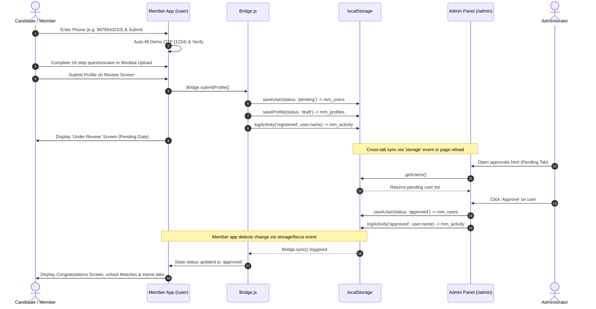
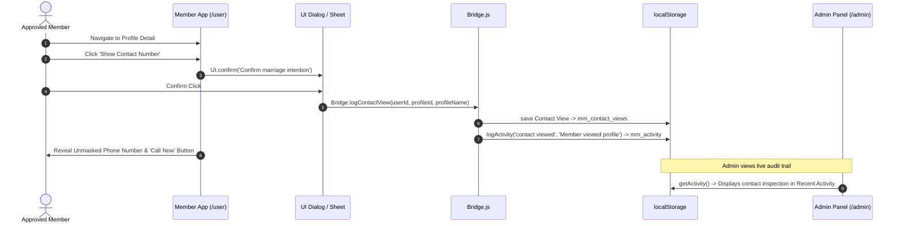
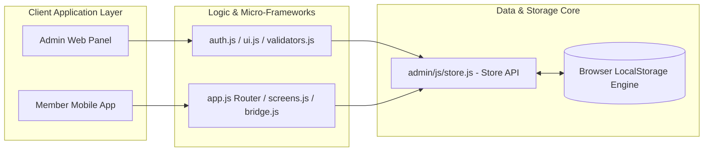

# 💍 Samaj Vivah: Complete Architectural Audit & System Documentation

**Document Version:** 1.0.0  
**Audit Date:** October 2026  
**Auditor Roles:** Senior Software Architect, Full-Stack Lead Engineer, Security Auditor & Technical Documentation Specialist  
**Repository:** `samaj_vivah` (`https://github.com/nawddeep/samaj_vivah.git`)  
**Target Environment:** Pure Web Standards (HTML5, Vanilla CSS3, Vanilla JavaScript ES6, LocalStorage Data Layer)

---

## Table of Contents
1. [Project Overview](#1-project-overview)
2. [Complete Project Structure](#2-complete-project-structure)
3. [Technology Stack](#3-technology-stack)
4. [System Architecture and Data Flow](#4-system-architecture-and-data-flow)
5. [Feature-by-Feature Analysis](#5-feature-by-feature-analysis)
6. [Frontend Audit](#6-frontend-audit)
7. [Backend and Virtual API Audit](#7-backend-and-virtual-api-audit)
8. [Database and Data Models](#8-database-and-data-models)
9. [Authentication and Security Audit](#9-authentication-and-security-audit)
10. [Dependencies and Environment Setup](#10-dependencies-and-environment-setup)
11. [Deployment and Infrastructure](#11-deployment-and-infrastructure)
12. [Bugs, Technical Debt, and Missing Features](#12-bugs-technical-debt-and-missing-features)
13. [Testing and Quality Assurance](#13-testing-and-quality-assurance)
14. [Developer Handover](#14-developer-handover)
15. [Final Project Summary & AI Handover Brief](#15-final-project-summary--ai-handover-brief)

---

## 1. Project Overview

### 1.1 Project Name and Purpose
**Samaj Vivah** (*Community Matrimonial Platform*) is a specialized web-based matrimonial application built specifically for the **Sindhi** community. The platform is structured as two interconnected applications sharing a synchronized client-side database:
1. **Admin Web Dashboard (`/admin`)**: A management portal for community elders/administrators to verify incoming member registrations, approve or reject users, publish and edit candidate profiles, upload and compress photos, monitor platform activity, and control profile visibility.
2. **Member Mobile Web App (`/user`)**: A mobile-viewport-optimized web application for prospective brides, grooms, and their families to register, upload biodata or fill an 18-step questionnaire, browse community matches with advanced filtering, send interests, chat, view verified contact details, and manage privacy settings.
3. **Portal Launcher (`/index.html`)**: An introductory root gateway explaining the dual-app architecture, providing one-click launch access to both apps and documenting test accounts.

### 1.2 The Problem It Solves
Traditional commercial matrimonial platforms (e.g., Shaadi.com, BharatMatrimony) cater broadly to all communities and are often polluted with unverified profiles, commercial spam, and loose community filtering. 
Single-community matchmaking requires:
- **Strict Community Identity & Verification:** Ensuring profiles belong to the specific community (e.g., Sindhi gotra, native origin, mother tongue).
- **Manual Gatekeeping:** Community administrators or trust elders must review and approve applicants before they can view full profile details or contact numbers.
- **Family-Centric Workflows:** Support for profiles created by parents, siblings, or relatives, not just candidates themselves.
- **Privacy & Dignity:** Preventing unauthorized contact harvesting, masking phone numbers until explicit confirmation, and providing granular photo privacy controls.

### 1.3 Target Users
1. **Community Candidates:** Sindhi individuals seeking life partners.
2. **Parents & Guardians:** Families looking for alliances for their sons, daughters, or relatives.
3. **Community Administrators:** Trust managers and matrimonial committee elders overseeing user verification and profile authenticity.

### 1.4 Development Stage
**Stage: High-Fidelity Interactive Prototype / Proof-of-Concept (PoC)**
- The codebase executes **100% offline** in any modern web browser.
- There are no external server dependencies, backend frameworks, or remote databases.
- The entire data layer, session management, file compression, and cross-app communication operate through browser APIs (`localStorage`, `CanvasRenderingContext2D`, `FileReader`, and `window.addEventListener('storage')`).

### 1.5 Implemented vs. Planned/Incomplete Scope

| Capability | Current Implementation Status | Planned / Production Requirements |
| :--- | :--- | :--- |
| **User Registration** | Implemented (Phone + simulated OTP `1234`) | Real SMS Gateway (Twilio, Gupshup, Fast2SMS) |
| **Candidate Onboarding** | Implemented (18-step wizard or biodata simulation) | AI/OCR parser for PDF/Image biodata extraction |
| **Profile Photos** | Implemented (Canvas Base64 compression & SVG avatars) | Cloud Storage (AWS S3, Cloudinary) with CDN |
| **Admin Verification** | Implemented (Pending/Approved/Rejected workflow) | Government ID verification (DigiLocker, Aadhaar API) |
| **Contact Access** | Implemented (Unmasking with confirmation & audit log) | Credit/Quota system with OTP verification |
| **Messaging / Chat** | Implemented (Mock threaded chat with quick replies) | Real-time WebSockets / Firebase / Matrix chat |
| **Monetization / Plans** | Implemented (UI pricing tiers and plan comparison) | Payment Gateway integration (Razorpay, Stripe) |
| **Data Persistence** | Implemented via `localStorage` (Isolated to origin) | Relational Database (PostgreSQL) + REST/GraphQL API |

---

## 2. Complete Project Structure

### 2.1 Repository Directory Tree
```text
samaj_vivah/
├── .agents/
│   └── skills/
│       └── code-review/
│           ├── SKILL.md
│           └── code-review.md
├── .git/
├── .gitignore
├── README.md
├── README.txt
├── index.html
├── admin/
│   ├── README.txt
│   ├── index.html
│   ├── dashboard.html
│   ├── approvals.html
│   ├── add-profile.html
│   ├── profiles.html
│   ├── users.html
│   ├── css/
│   │   ├── theme.css
│   │   └── layout.css
│   └── js/
│       ├── store.js
│       ├── auth.js
│       ├── ui.js
│       ├── validators.js
│       ├── dashboard.js
│       ├── approvals.js
│       ├── profiles.js
│       ├── add-profile.js
│       └── users.js
└── user/
    ├── README.txt
    ├── index.html
    ├── css/
    │   ├── theme.css
    │   └── app.css
    └── js/
        ├── data.js
        ├── bridge.js
        ├── app.js
        └── screens.js
```

### 2.2 Directory & File Purpose Breakdown

#### Root Files
- **`index.html` (73 lines)**: Main presentation gateway. Explains how the dual-app prototype works, provides test credentials, and launches `/user/index.html` and `/admin/index.html` in new tabs.
- **`README.md` (94 lines)**: Comprehensive project overview, quick start commands, credentials, feature summary, and `localStorage` keys.
- **`README.txt` (21 lines)**: Plain-text quick manual for developers.
- **`.gitignore` (4 lines)**: Excludes `.DS_Store`, `*.log`, and `node_modules/`.

#### Admin Subsystem (`admin/`)
- **`admin/index.html` (237 lines)**: Admin login screen with validation, demo credential banner, password toggle, and redirect to `dashboard.html`.
- **`admin/dashboard.html` (260 lines)**: Executive dashboard with 4 metric cards, 2 HTML5 Canvas charts (Donut & Bar), quick insights, and recent activity log.
- **`admin/approvals.html` (215 lines)**: Queue for user registration approvals across 3 tabs (Pending, Approved, Rejected) with candidate details modal and rejection reason requirements.
- **`admin/add-profile.html` (435 lines)**: Multi-section profile authoring and editing form (`?id=prf_xxx`), photo dropzone, canvas image compression, PDF attachment uploader, and validation.
- **`admin/profiles.html` (294 lines)**: Profiles management table and mobile card view, search, multi-filters (status, gender, age), sorting, pagination, unmasked contact modal, and hide/unhide modal.
- **`admin/users.html` (206 lines)**: Registered user registry with search, status filters, account details modal, block/unblock controls, and permanent deletion.
- **`admin/css/theme.css` (622 lines)**: Design tokens (`--maroon`, `--cream`, `--gold`, `--ivory`), typography, buttons, form controls, badges, empty states, and toast notifications.
- **`admin/css/layout.css` (497 lines)**: Responsive admin layout, sidebar navigation drawer, top header bar, grid systems, data tables, and mobile responsive breakpoints.
- **`admin/js/store.js` (622 lines)**: **Core Data Layer**. Defines `STORAGE_KEYS`, procedural SVG avatar generator (`generateSvgAvatar`), initial seed data injection (`seedIfEmpty`), and CRUD functions (`getUsers`, `saveUser`, `deleteUser`, `getProfiles`, `saveProfile`, `deleteProfile`, `getSession`, `setSession`, `clearSession`, `logActivity`, `resetDemoData`).
- **`admin/js/auth.js` (66 lines)**: Admin authentication controller (`DEMO_CREDENTIALS`), session state check (`isLoggedIn`), login/logout handlers, and immediate client-side route guard (`initGuard`).
- **`admin/js/ui.js` (512 lines)**: UI library providing SVG icons (`SVG_ICONS`), XSS escaper (`escapeHtml`), phone number masker (`maskPhoneNumber`), date formatters (`formatDate`, `formatTimeAgo`), toast notification engine (`showToast`), confirmation modal (`showConfirmModal`), generic modal (`showModal`), photo lightbox gallery (`openLightbox`), canvas chart generators (`drawCanvasBarChart`, `drawCanvasDonutChart`), and mobile menu handlers.
- **`admin/js/validators.js` (135 lines)**: Validation rules: login credentials, rejection reason minimum length (5 chars), profile form validation (draft vs. publish rules, age limits 18–70, 10-digit Indian phone regex `^[6-9]\d{9}$`, duplicate phone check across profiles), photo file constraints (JPG/PNG/WEBP <= 2MB), and biodata constraints (JPG/PNG/PDF <= 3MB).
- **`admin/js/dashboard.js` (150 lines)**: Dashboard page controller. Computes metrics from store, renders canvas charts on load and window resize, and formats activity items.
- **`admin/js/approvals.js` (314 lines)**: Approvals page controller. Manages tab filtering, badge counters, user detail inspection modal, one-click approval, and reason-backed rejection.
- **`admin/js/profiles.js` (454 lines)**: Profiles page controller. Search query filtering across Name, City, Phone, and Profession; multi-criteria dropdown filtering; sorting; 10-item pagination; unmasked verified contact viewer; and hide/unhide with reason.
- **`admin/js/add-profile.js` (395 lines)**: Profile form controller. URL query parameter parsing for edit mode, form pre-population, dirty form change tracking (`beforeunload`), photo file handling and canvas compression, PDF reader, and draft/publish dispatch.
- **`admin/js/users.js` (283 lines)**: User registry controller. Real-time search, status filtering, account detail inspection, block/unblock toggles, and deletion.

#### Member Subsystem (`user/`)
- **`user/index.html` (40 lines)**: Mobile web app shell. Declares `<div class="phone" id="app">`, sticky access banner, stage container `<main id="stage">`, bottom navigation bar `<nav id="bottom-nav">`, toast root, and layer root. Loads `../admin/js/store.js`, `data.js`, `bridge.js`, `app.js`, `screens.js`, and boots `Router.start()`.
- **`user/css/theme.css` (285 lines)**: Member app design tokens, button styles, form controls, bottom sheet transitions, dialogs, badges, and skeleton loaders.
- **`user/css/app.css` (584 lines)**: Mobile phone container frame (centered phone canvas with shadow), question step layouts, profile card carousels, chat bubbles, interest list items, and responsive mobile adaptations.
- **`user/js/data.js` (433 lines)**: Community options dictionary (`OPTIONS`), location hierarchical tree (`LOCATIONS`), inline SVG avatar illustration generator (`makeAvatar`, `makePhotoSet`), 20 pre-seeded approved profiles (`PEOPLE`), sample profile builder (`sampleProfile`), mock chats (`CHATS`), notifications (`NOTIFICATIONS`), success stories (`STORIES`), membership plans (`PLANS`), and FAQ data (`FAQ`).
- **`user/js/bridge.js` (380 lines)**: **Integration Bridge**. Translates between member app data models and admin `store.js` records. Handles user session (`mm_user_session`), shortlists (`mm_shortlist`), contact access logs (`mm_contact_views`), profile transformation (`adapt`, `storedFromOnboarding`), and cross-tab status syncing.
- **`user/js/app.js` (465 lines)**: Micro-framework for member app: DOM element factory `h()`, node clearance `clearNode()`, unique ID generator `uid()`, debounce utility, icon dictionary (`Icon`), in-memory state (`State`), Role-Based Access Control matrix (`ACCESS`, `canUse()`), popups/dialogs/bottom-sheets (`UI.toast`, `UI.dialog`, `UI.confirm`, `UI.sheet`), and hash-based SPA router (`Router`) with animated slide/fade transitions.
- **`user/js/screens.js` (3,000 lines)**: All screen definitions and interactive controllers:
  - *Onboarding:* `splash`, `welcome`, `phone`, `otp`, `choice`, `bioUpload`, `bioReading`, 18 questionnaire steps (`profileFor`, `gender`, `name`, `dob`, `marital`, `height`, `community`, `location`, `education`, `work`, `lifestyle`, `horoscope`, `family`, `about`, `partner`, `photos`, `documents`), and `review`.
  - *Lifecycle Gates:* `pending`, `approved`, `rejected`, `blocked`.
  - *Main Experience:* `home`, `matches`, `profile` (detail viewer), `myprofile`, `interests`, `shortlist`, `messages`, `chat`, `notifications`.
  - *Account & Utilities:* `account`, `editProfile`, `verification`, `plans`, `stories`, `settings`, `help`, `aboutApp`.

---

## 3. Technology Stack

| Layer | Technology | Version / Spec | Purpose & Implementation Details |
| :--- | :--- | :--- | :--- |
| **Markup** | HTML5 | Living Standard | Semantic document structures, accessible labels, meta tags, and SVG definitions. |
| **Styling** | Vanilla CSS3 | W3C Modern CSS | Custom properties (CSS variables), Flexbox, CSS Grid, mobile container query emulation, and CSS animations. Zero external CSS frameworks (no Tailwind, no Bootstrap). |
| **Scripting** | Vanilla JavaScript | ECMAScript 2020 (ES6+) | Application logic, DOM manipulation, custom routing, state management, and file reading. Zero npm packages or JS frameworks (no React, Vue, jQuery, or Lodash). |
| **Typography** | Google Fonts | Web Fonts API | `'Playfair Display'` (serif headings) and `'Poppins'` (sans-serif body text) loaded via CDN. |
| **Graphics & Icons** | Vector SVG & HTML5 Canvas | SVG 1.1 / Canvas 2D | Custom inline SVG icon systems (`SVG_ICONS` and `ICON_PATHS`). Custom procedural vector avatars generated mathematically via `makeAvatar()` and `generateSvgAvatar()`. Charts drawn directly on `<canvas>`. |
| **Image Compression** | HTML5 Canvas 2D API | Canvas API | Client-side image resizing and JPEG/PNG compression to Base64 (max width 800px, 75% quality) via `compressImage()`. |
| **Data Storage** | Browser `localStorage` | Web Storage API | Persistent key-value JSON document store shared across tabs on the same origin. |
| **Client Routing** | Custom SPA Router | HTML5 History API (`hashchange` & `pushState`) | Hash-based routing (`#/route/param`) in user app; standard multi-page documents (`.html`) in admin panel. |
| **Execution Environment**| Any Web Browser | Evergreen Browsers | Chrome, Firefox, Safari, Edge, or simple HTTP servers (`python3 -m http.server`, VS Code Live Server, Nginx, Vercel). |

---

## 4. System Architecture and Data Flow

### 4.1 System Architecture Diagram

```mermaid
graph TB
    subgraph Browser Context [Single Browser Origin (e.g., http://localhost:8080)]
        subgraph Admin Portal [Admin Panel (/admin)]
            A_Login[index.html - Login & Auth Guard]
            A_Dash[dashboard.html - Metrics & Canvas Charts]
            A_Appr[approvals.html - User Approval Queue]
            A_Prof[profiles.html - Profile Registry & Filters]
            A_Add[add-profile.html - Profile Editor & Compressor]
            A_User[users.html - User Registry & Blocking]
            A_Store[store.js - Store CRUD & Seed Engine]
            A_UI[ui.js - Modals, Charts, Lightbox]
            A_Valid[validators.js - Form Validation Rules]
        end

        subgraph Member App [Member Mobile App (/user)]
            U_Index[index.html - Viewport Shell]
            U_Router[app.js - Hash Router & Access Matrix]
            U_Screens[screens.js - 28+ Screens & Wizards]
            U_Bridge[bridge.js - Model Adapter & Sync]
            U_Data[data.js - Mock Dictionaries & Avatar Engine]
        end

        subgraph Shared Storage Layer [Browser LocalStorage]
            K_Users[(mm_users - User Records)]
            K_Profiles[(mm_profiles - Candidate Profiles)]
            K_Activity[(mm_activity - Audit Logs)]
            K_AdminSess[(mm_admin_session - Admin Session)]
            K_UserSess[(mm_user_session - Member Session)]
            K_Shortlist[(mm_shortlist - Bookmarked Profiles)]
            K_Views[(mm_contact_views - Contact View Logs)]
        end
    end

    %% Admin Connections
    A_Dash --> A_Store
    A_Appr --> A_Store
    A_Prof --> A_Store
    A_Add --> A_Store
    A_User --> A_Store
    A_Store --> K_Users
    A_Store --> K_Profiles
    A_Store --> K_Activity
    A_Login --> K_AdminSess

    %% User Connections
    U_Index --> U_Router
    U_Router --> U_Screens
    U_Screens --> U_Bridge
    U_Bridge --> A_Store
    U_Bridge --> K_UserSess
    U_Bridge --> K_Shortlist
    U_Bridge --> K_Views

    %% Cross-Tab Sync
    K_Users -. Storage Event / Visibility Sync .-> U_Bridge
    K_Profiles -. Storage Event / Visibility Sync .-> U_Bridge
    U_Bridge -. Log Activity .-> K_Activity
```

---

### 4.2 Sequence Diagram: Member Onboarding & Admin Approval Workflow



---

### 4.3 Sequence Diagram: Verified Contact Access & Audit Logging



---

## 5. Feature-by-Feature Analysis

| Feature Name | Functional Description | Frontend Files | Backend / Storage Keys | Current Status | Known Limitations & Edge Cases |
| :--- | :--- | :--- | :--- | :--- | :--- |
| **Admin Authentication** | Login form with credential matching, password toggle, session guard, and logout. | `admin/index.html`, `admin/js/auth.js`, `admin/js/ui.js` | `mm_admin_session` | Complete (Prototype) | Hardcoded credentials (`admin@demo.com` / `Admin@123`). Session token is an unhashed string. |
| **Analytics Dashboard** | Displays 4 metric counts, profile status donut chart, user status bar chart, and activity feed. | `admin/dashboard.html`, `admin/js/dashboard.js`, `admin/js/ui.js` | `mm_users`, `mm_profiles`, `mm_activity` | Complete | Charts rendered via raw Canvas 2D; lacks dynamic tooltips and deep date-range query filters. |
| **Registration Approvals** | 3-tab queue (Pending, Approved, Rejected) with candidate details modal and approval/rejection triggers. | `admin/approvals.html`, `admin/js/approvals.js`, `admin/js/validators.js` | `mm_users`, `mm_activity` | Complete | Rejection reason must be >= 5 chars. No multi-admin review voting or bulk approval capability. |
| **Profile Authoring & Editing** | Multi-card candidate form, canvas photo compression, PDF upload, duplicate phone detection. | `admin/add-profile.html`, `admin/js/add-profile.js`, `admin/js/validators.js` | `mm_profiles`, `mm_activity` | Complete | Photos stored as Base64 strings directly in `localStorage`; 5MB browser storage ceiling risk. |
| **Profile Registry & Search** | Table & mobile card views, real-time search, filters (Status, Gender, Age), sorting, pagination. | `admin/profiles.html`, `admin/js/profiles.js`, `admin/js/ui.js` | `mm_profiles`, `mm_activity` | Complete | Search is client-side in-memory substring match. Pagination fixed at 10 items/page. |
| **Contact Detail Unmasking** | Modal displaying unmasked contact numbers with "Call Now" intent links. | `admin/profiles.html`, `admin/users.html`, `user/js/screens.js` | `mm_profiles`, `mm_contact_views`, `mm_activity` | Complete | Full numbers visible to any admin; in user app, visible only upon status confirmation. |
| **User Account Controls** | User search, masked view, status filter, block/unblock workflow, and permanent deletion. | `admin/users.html`, `admin/js/users.js` | `mm_users`, `mm_activity` | Complete | Deleting a user does not automatically purge their attached profiles in admin manual mode. |
| **Data Store Reset** | Restores all users, profiles, and activities to factory seed state. | `admin/js/store.js`, `admin/js/ui.js` | All `localStorage` keys | Complete | Completely purges custom data without an export/download step. |
| **Member Auth & OTP** | Mobile number entry with auto-filling simulated 4-digit OTP (`1234`). | `user/js/screens.js`, `user/js/bridge.js` | `mm_users`, `mm_user_session` | Complete (Simulated) | OTP is static (`1234`). No real SMS gateway or rate limiter. |
| **Candidate Onboarding** | 18-step wizard capturing personal, family, career, lifestyle, horoscope, and preferences. | `user/js/screens.js`, `user/js/app.js` | In-memory `State.profile` | Complete | Step state is held in-memory until final Review submission; browser reload mid-form resets progress. |
| **Biodata Upload Simulation** | Uploads PDF/image biodata and simulates an automated 3-second OCR data extraction. | `user/js/screens.js`, `user/js/data.js` | In-memory `State.profile` | Complete (Simulated) | Extraction is hardcoded mock data (`sampleProfile()`); no actual computer vision/OCR running. |
| **Match Discovery & Filters** | Browsing candidate cards with compatibility score, quick filters, and search. | `user/js/screens.js`, `user/js/bridge.js`, `user/js/data.js` | `mm_profiles` | Complete | Compatibility score is pseudo-randomly calculated (`COMPAT` array / hash of ID). |
| **Shortlist & Bookmarks** | Save and remove candidate profiles into a private shortlist tab. | `user/js/screens.js`, `user/js/bridge.js` | `mm_shortlist` | Complete | Stored per user ID in `mm_shortlist`. |
| **Interests Management** | Send, accept, and decline matrimonial interest requests across Sent and Received tabs. | `user/js/screens.js`, `user/js/data.js` | In-memory `INTERESTS` array | Partial (In-Memory) | Changes made to interest status do not persist across full page reloads. |
| **In-App Messaging / Chat** | Threaded conversation view with message history, quick replies, and message input. | `user/js/screens.js`, `user/js/data.js` | In-memory `CHATS` array | Partial (In-Memory) | Chat messages are held in runtime memory; new typed messages vanish on hard refresh. |
| **Photo Privacy Controls** | Choose photo visibility: All Members, Approved Members Only, or Upon Accepted Interest. | `user/js/screens.js`, `user/js/bridge.js` | `mm_users` (`profileData`) | Complete | In the web demo, photo blurring is simulated; full watermarking requires native mobile DRM. |
| **Account Deletion (Member)**| Member self-service account termination purging user record and drafted profile. | `user/js/screens.js`, `user/js/bridge.js` | `mm_users`, `mm_profiles`, `mm_shortlist`, `mm_user_session` | Complete | Immediate purge; no 30-day soft-delete grace period. |

---

## 6. Frontend Audit

### 6.1 Application Layouts & Viewports
- **Admin Panel:** Desktop-first responsive layout (`admin/css/layout.css`) utilizing a fixed 260px collapsible sidebar, top action header, and responsive content area. At viewports `<992px`, the sidebar transitions into an off-canvas drawer controlled by `.mobile-menu-toggle` and `.sidebar-overlay`.
- **Member App:** Mobile-first viewport container (`user/css/app.css`). On desktop monitors, it presents a simulated mobile frame (max-width: 430px, border-radius: 40px, box-shadow) centered on screen. On mobile devices (`<600px`), it expands to 100% viewport width and 100% height (`viewport-fit=cover`).

### 6.2 Routing & Navigation Architecture
- **Admin Routing:** Multi-Page Application (MPA). Navigation occurs via standard anchor links (`href="dashboard.html"`, `href="profiles.html"`). Authentication protection is handled synchronously on script load by `Auth.initGuard()` in `auth.js`.
- **Member Routing:** Single-Page Application (SPA) driven by a custom hash router (`Router` in `user/js/app.js`).
  - Routes adhere to the `#/screenName/param` format.
  - State stack tracks forward vs. backward navigation (`Router.index()`, `Router.backBy()`) enabling animated CSS slide transitions (`anim-in-right`, `anim-out-left`, `anim-fade`).
  - Gated navigation: `Router.gateName()` dynamically computes destination screens based on `State.status` (`none`, `pending`, `approved`, `rejected`, `blocked`).

### 6.3 State Management & Data Fetching
- **No Remote Network Fetching:** The network tab shows zero AJAX/Fetch/XHR calls. Data is retrieved synchronously via `localStorage.getItem()` and parsed through `safeGetItem()`.
- **In-Memory Volatile State:** Transient states (e.g., active questionnaire step answers, active filters, open lightbox modal index, unread chat inputs) are held in global scope objects (`State` in `app.js`, `filteredProfiles` in `profiles.js`).
- **Cross-Tab Reactivity:** Real-time synchronization between the Member App tab and the Admin Panel tab is achieved via `window.addEventListener('storage', ...)` and `document.addEventListener('visibilitychange', ...)`. When an admin approves a candidate in the admin tab, the member app instantly detects the change and navigates the user to the `approved` screen without manual refresh.

### 6.4 Form Validation & Security Helpers
- **Input Sanitization:** `escapeHtml()` in `admin/js/ui.js` sanitizes all dynamic user strings before DOM insertion (`&`, `<`, `>`, `"`, `'`).
- **DOM Factory:** `h()` in `user/js/app.js` sets text content exclusively via `node.textContent` and `document.createTextNode()`, eliminating `innerHTML` injection risks for user-generated strings.
- **Form Error Feedback:** `Validators.validateProfile()` performs field-level inspection, activates `.has-error` and `.is-invalid` classes, displays custom `.invalid-feedback` messages, and smoothly scrolls to the first invalid field.

---

## 7. Backend and Virtual API Audit

Because the project currently runs purely client-side, the "backend" consists of the Store and Bridge API methods. Below is the specification of this **Virtual API Layer**, formatted as the RESTful endpoints it currently simulates and that a production backend must implement:

### 7.1 Virtual API Specification

| Simulated Endpoint | HTTP Method | Internal JavaScript Method | Purpose & Payload | Storage Operation | Callers |
| :--- | :--- | :--- | :--- | :--- | :--- |
| `/api/auth/admin/login` | `POST` | `Auth.login(email, password)` | Authenticates admin credentials. Body: `{ email, password }` | Writes `mm_admin_session` | `admin/index.html` |
| `/api/auth/admin/logout`| `POST` | `Auth.logout()` | Clears admin session. | Removes `mm_admin_session` | `admin/js/ui.js` (header & sidebar) |
| `/api/auth/user/otp` | `POST` | `Bridge.login(phone)` | Validates OTP and initializes member session. Body: `{ phone, otp }` | Writes `mm_user_session` | `user/js/screens.js` (`otp` screen) |
| `/api/users` | `GET` | `getUsers()` | Fetches all registered user accounts. | Reads `mm_users` | `admin/approvals.js`, `admin/users.js`, `admin/dashboard.js` |
| `/api/users/:id` | `PUT` | `saveUser(user)` | Updates user status, relation, or details. Body: `User` object | Updates item in `mm_users` | `admin/approvals.js`, `admin/users.js`, `bridge.js` |
| `/api/users/:id` | `DELETE` | `deleteUser(id)` | Permanently removes user account. | Filters out item in `mm_users` | `admin/users.js`, `bridge.deleteAccount()` |
| `/api/profiles` | `GET` | `getProfiles()` | Retrieves all matrimonial profiles. | Reads `mm_profiles` | `admin/profiles.js`, `admin/dashboard.js`, `bridge.js` |
| `/api/profiles/:id` | `GET` | `getProfileById(id)` | Fetches single profile by ID. | Finds item in `mm_profiles` | `admin/add-profile.js`, `admin/profiles.js` |
| `/api/profiles` | `POST` / `PUT` | `saveProfile(profile)` | Creates or updates profile. Body: `Profile` object | Updates/unshifts in `mm_profiles` | `admin/add-profile.js`, `admin/profiles.js`, `bridge.js` |
| `/api/profiles/:id` | `DELETE` | `deleteProfile(id)` | Permanently deletes candidate profile. | Filters out item in `mm_profiles` | `admin/profiles.js`, `bridge.deleteAccount()` |
| `/api/activity` | `GET` | `getActivity()` | Retrieves recent system audit events (capped at 50). | Reads `mm_activity` | `admin/dashboard.js` |
| `/api/activity` | `POST` | `logActivity(action, target)`| Appends new audit log entry. | Unshifts item to `mm_activity` | Store, Bridge, and Admin controllers |
| `/api/system/reset` | `POST` | `resetDemoData()` | Purges all keys and re-seeds default demo data. | Clears and re-seeds `localStorage` | `admin/js/ui.js` (Reset Demo button) |
| `/api/shortlist` | `GET` / `POST` | `Bridge.loadShortlist()`, `Bridge.saveShortlist()` | Manages member bookmarks. | Reads/writes `mm_shortlist` | `user/js/screens.js` (`shortlist`, `matches`) |
| `/api/contacts/view` | `POST` | `Bridge.logContactView()` | Records unmasking of contact number. | Appends to `mm_contact_views` | `user/js/screens.js` (`profile` screen) |

---

## 8. Database and Data Models

### 8.1 Entity-Relationship (ER) Diagram

```mermaid
erDiagram
    USER ||--o| PROFILE : "owns / created for"
    USER ||--o{ SHORTLIST : "saves"
    USER ||--o{ CONTACT_VIEW : "inspects"
    PROFILE ||--o{ SHORTLIST : "bookmarked in"
    PROFILE ||--o{ CONTACT_VIEW : "viewed in"
    ADMIN_SESSION ||--o{ ACTIVITY_LOG : "triggers (audit)"

    USER {
        string id PK "usr_xxx"
        string name "Full Name"
        string phone "10-digit Phone"
        string city "City Name"
        string relation "self | parent | sibling | relative"
        string status "pending | approved | rejected | blocked"
        string rejectReason "Mandatory reason if rejected"
        boolean seenApproved "Flag for congratulations screen"
        string profileId FK "prf_xxx (Linked Profile)"
        object profileData "Volatile onboarding snapshot"
        datetime createdAt "ISO timestamp"
    }

    PROFILE {
        string id PK "prf_xxx"
        string userId FK "usr_xxx (Owner)"
        string name "Candidate Full Name"
        string gender "male | female"
        integer age "18 - 70"
        string height "5'10\" format"
        string maritalStatus "Never Married | Divorced | Widowed"
        string education "Degree & Specialization"
        string profession "Designation"
        string income "e.g. 15-20 LPA"
        string city "Current City"
        string religionDetails "e.g. Hindu - Sindhi"
        string fatherName "Father's Name"
        string fatherOccupation "Father's Profession"
        string motherName "Mother's Name"
        string siblings "Sibling details"
        string familyType "Nuclear | Joint"
        string expectations "Partner Expectations text"
        string contactNumber "10-digit Phone"
        array photos "Base64 or SVG data URIs (max 5)"
        object biodataFile "name and Base64 data"
        string status "published | hidden | draft"
        datetime createdAt "ISO timestamp"
        datetime updatedAt "ISO timestamp"
    }

    ADMIN_SESSION {
        string token PK "demo_token_xxx"
        string email "admin@demo.com"
        string name "System Admin"
        string role "Administrator"
        datetime loginTime "ISO timestamp"
    }

    ACTIVITY_LOG {
        string id PK "act_xxx"
        string action "approved | rejected | published | hidden | etc."
        string target "Entity description label"
        datetime time "ISO timestamp"
    }

    SHORTLIST {
        string userId FK "usr_xxx"
        string profileId FK "prf_xxx"
        datetime savedAt "ISO timestamp"
    }

    CONTACT_VIEW {
        string id PK "cv_xxx"
        string userId FK "usr_xxx"
        string profileId FK "prf_xxx"
        datetime time "ISO timestamp"
    }
```

### 8.2 Data Store Keys & Integrity Rules

1. **`mm_users`**: Array of `User` objects.
   - *Integrity constraint:* `phone` must be unique across accounts. Handled by client-side uniqueness checks.
2. **`mm_profiles`**: Array of `Profile` objects.
   - *Integrity constraint:* `contactNumber` must be 10 digits starting with 6–9. Cannot duplicate an existing profile's contact number (enforced in `Validators.validateProfile`).
3. **`mm_activity`**: Rolling circular buffer capped at the **last 50 log entries** (`activities.length > 50 ? activities.pop() : null`).
4. **`mm_admin_session`**: Single JSON object representing the admin session. Destroyed on logout.
5. **`mm_user_session`**: Single JSON object representing active member session (`{ userId, phone, loggedInAt }`).
6. **`mm_shortlist`**: Array of `{ userId, profileId, savedAt }` records.
7. **`mm_contact_views`**: Array of `{ id, userId, profileId, time }` records.

---

## 9. Authentication and Security Audit

### 9.1 Security Vulnerability Matrix

| ID | Vulnerability Description | Severity | Evidence in Code | Impact | Recommended Production Fix |
| :--- | :--- | :--- | :--- | :--- | :--- |
| **SEC-01** | **Hardcoded Plaintext Admin Credentials** | **CRITICAL** | `admin/js/auth.js:5-8` (`admin@demo.com` / `Admin@123`) | Anyone inspecting client JS can view and replicate admin credentials immediately. | Move authentication to a secure server endpoint using bcrypt/Argon2 hashing, issuing HTTP-only secure JWT cookies. |
| **SEC-02** | **Simulated / Static OTP Bypass** | **CRITICAL** | `user/js/data.js:6` (`DEMO_OTP = '1234'`) | Any user can access any registered account by typing the number and `1234`. | Integrate real SMS gateway, generate cryptographically random 6-digit OTPs with Redis TTL (5 min expiry) and 3-attempt lockouts. |
| **SEC-03** | **Unrestricted LocalStorage Data Access** | **HIGH** | `admin/js/store.js:28-45` | Any script executing in the browser or XSS payload can dump the entire database via `localStorage.getItem('mm_users')`. | Store sensitive PII on a secured backend database behind authenticated REST endpoints. Never place full user registries in browser storage. |
| **SEC-04** | **Unprotected Route Guard Bypass** | **HIGH** | `admin/js/auth.js:48-61` (`initGuard`) | A client can disable JavaScript or alter `Auth.isLoggedIn()` in DevTools to view and manipulate admin pages. | Implement server-side session authentication with middleware route guards preventing unauthorized HTML delivery. |
| **SEC-05** | **LocalStorage Quota Exhaustion (DoS)** | **HIGH** | `admin/js/add-profile.js:164` | Photos and PDFs are stored as Base64 strings. Exceeding browser 5MB `localStorage` limit throws `QuotaExceededError`. | Upload files to object storage (AWS S3, Cloudflare R2) and store only HTTPS URL strings in the database. |
| **SEC-06** | **Unmasked PII Exposure in Client Store** | **MEDIUM** | `admin/js/store.js:66` | Full phone numbers and family addresses exist in client memory, even when masked visually in DOM. | Backend must mask sensitive fields before sending payloads to non-privileged clients; full numbers sent only upon authorized request. |
| **SEC-07** | **Absence of Rate Limiting & CSRF Protection** | **LOW** | System Architecture | No rate limits on login attempts, contact reveals, or profile creation. | Implement rate limiting middleware (e.g., Redis Token Bucket) and CSRF tokens for state-changing endpoints in production. |

---

## 10. Dependencies and Environment Setup

### 10.1 Required Runtimes & Dependencies
- **Node.js / npm:** **Not required**. There is no `package.json`, build configuration, or node dependency.
- **Runtimes:** Any modern desktop or mobile web browser supporting ECMAScript 6+ and HTML5 Canvas (Chrome 90+, Safari 14+, Firefox 88+, Edge 90+).
- **External Network Access:** Only required to load Google Fonts (`Playfair Display`, `Poppins`). If offline, system serif and sans-serif fallback fonts (`Georgia`, `system-ui`) render seamlessly.

### 10.2 Local Development Commands
To start a local development server on any operating system:

```bash
# 1. Clone or navigate to the project directory
cd /path/to/samaj_vivah

# 2. Start an HTTP server using Python 3 (Recommended)
python3 -m http.server 8080

# Or start using Node.js 'npx serve' (if Node is installed)
npx -y serve -l 8080 .

# Or start using PHP built-in server
php -S localhost:8080
```
Open your browser and navigate to:
- **Root Gateway:** `http://localhost:8080/index.html`
- **Member Mobile Web App:** `http://localhost:8080/user/index.html`
- **Admin Dashboard:** `http://localhost:8080/admin/index.html`

### 10.3 Common Setup Errors & Solutions
- **Error: Changes in Admin do not show in Member App:**  
  *Cause:* The two apps were opened from different origins (e.g., opening one via `file:///` and another via `http://localhost`).  
  *Solution:* Always access both apps through the identical hostname and port (e.g. `http://localhost:8080/`).
- **Error: "Browser storage full or blocked" Toast Alert:**  
  *Cause:* Uploading multiple uncompressed high-resolution images or large PDFs exceeded browser `localStorage` quota (~5MB).  
  *Solution:* Click "Reset Demo Data" in the admin sidebar or keep uploaded photos under 1MB.

---

## 11. Deployment and Infrastructure

### 11.1 Current Deployment Configuration
Because the application consists entirely of static assets (HTML, CSS, JS), it can be deployed to any static web hosting provider without build steps, servers, or containerization.

- **Vercel / Netlify:**
  - Build Command: *(None / leave empty)*
  - Output Directory: `.` (Project root)
  - Framework Preset: `Other`
- **GitHub Pages:**
  - Deploy directly from the `main` branch root.
- **AWS S3 + CloudFront:**
  - Sync repository files to an S3 bucket configured for Static Website Hosting and serve via CloudFront with HTTPS.

### 11.2 Production Infrastructure Requirements (Future State)
When graduating from Prototype to Production, the following target architecture is required:
1. **Frontend:** Next.js or React + Vite hosted on Vercel or AWS CloudFront.
2. **Backend API:** Node.js (Express / Fastify) or Go / Python (FastAPI) deployed on AWS ECS, Render, or GCP Cloud Run.
3. **Database:** Managed PostgreSQL (AWS RDS, Supabase, Neon) with Prisma or Drizzle ORM.
4. **Media Storage:** AWS S3 or Cloudinary with automated thumbnail generation and watermarking.
5. **Real-Time Layer:** Socket.io or Firebase Cloud Messaging for instant chat and push notifications.

---

## 12. Bugs, Technical Debt, and Missing Features

### 12.1 Priority Issue Matrix

| Issue ID | Category | Severity | Description | Evidence / Location | Recommended Fix |
| :--- | :--- | :--- | :--- | :--- | :--- |
| **BUG-01** | Data Loss | **HIGH** | In-Memory Chat & Interests do not persist across hard reloads. | `user/js/data.js:368-401` | Move `INTERESTS` and `CHATS` to `localStorage` or backend database so user messages persist. |
| **BUG-02** | Data Leak | **MEDIUM** | Storage quota failure risk on large Base64 attachments. | `admin/js/store.js:488-501` | Catch quota errors gracefully, limit max image uploads, and prevent Base64 bloat. |
| **BUG-03** | UI / Flow | **MEDIUM** | Member app reload during 18-step onboarding wipes form state. | `user/js/app.js:100-117` | Save draft onboarding steps in `sessionStorage` or `localStorage` keyed to phone number. |
| **DEBT-01** | Architecture | **HIGH** | Monolithic 3,000-line screen controller file. | `user/js/screens.js` (2,999 lines) | Split `screens.js` into modular files (`screens/onboarding.js`, `screens/matches.js`, `screens/chat.js`). |
| **DEBT-02** | Redundancy | **MEDIUM** | Duplicated Avatar generator logic. | `admin/js/store.js:13` vs `user/js/data.js:130` | Consolidate avatar generation into a single shared SVG utility module. |
| **MISS-01** | Functional | **HIGH** | Missing real SMS OTP verification service. | `user/js/screens.js:1055` | Integrate a production SMS API gateway. |
| **MISS-02** | Functional | **HIGH** | Simulated OCR / Biodata parsing. | `user/js/screens.js:1170` | Connect to Google Cloud Document AI or Tesseract.js for actual biodata text extraction. |
| **MISS-03** | Security | **HIGH** | Lack of real screenshot protection on web. | `user/README.txt:6` | Note in docs that client-side DRM requires native Flutter/Kotlin wrapper on mobile devices. |

---

## 13. Testing and Quality Assurance

### 13.1 Current Test Coverage Audit
- **Unit Tests:** **0%** (No test runner, Jest, Vitest, or test files exist).
- **Integration Tests:** **0%**.
- **End-to-End (E2E) Tests:** **0%** (No Cypress or Playwright configurations).
- **Linting / QA Tools:** No ESLint or Prettier configs detected.

### 13.2 Recommended QA Suite for Production Handover
1. **Unit Testing:** Vitest for `Validators` (`validators.test.js`) and `Store` CRUD operations.
2. **Component Testing:** Testing form error display, photo compression canvas outputs, and phone masking logic.
3. **E2E Testing:** Playwright test suite covering:
   - Complete Admin login -> Approve user -> Verify member app unlocked.
   - User onboarding wizard -> Review screen submission -> Admin queue appearance.
   - Profile creation with photos -> Compress -> Verify table listing.

---

## 14. Developer Handover

### 14.1 Top 5 Files to Read First
1. **`admin/js/store.js`**: Understand the entire data schema, seed records, and CRUD operations.
2. **`user/js/bridge.js`**: Understand how member onboarding data maps to admin profiles and how cross-tab syncing works.
3. **`user/js/app.js`**: Understand the core UI micro-framework, `State` machine, RBAC access matrix, and `Router`.
4. **`admin/js/auth.js` & `admin/js/validators.js`**: Understand validation constraints, session guarding, and regex rules.
5. **`user/js/screens.js`**: Understand individual screen flows, UI component rendering, and user interactions.

### 14.2 Next 10 Recommended Development Tasks (Prioritized)
1. **Task 1: Split `user/js/screens.js` into Modular Files:** Break up the 3,000-line file into domain-specific modules (`onboarding.js`, `matches.js`, `chat.js`, `account.js`).
2. **Task 2: Implement Persistent Storage for Chats and Interests:** Store sent/received interests and chat message threads in `localStorage` (`mm_interests`, `mm_chats`) so conversations persist.
3. **Task 3: Implement Draft Onboarding Persistence:** Auto-save member onboarding form state after every step to prevent data loss on accidental page reload.
4. **Task 4: Setup ESLint & Prettier Configuration:** Add basic linting and code formatting rules to standardize Vanilla JS styles.
5. **Task 5: Add Automated E2E Tests (Playwright):** Create a Playwright suite verifying the full dual-app approval cycle.
6. **Task 6: Build REST Backend Service:** Scaffold a Node.js (Fastify/Express) or Python (FastAPI) server replacing `store.js` localStorage calls with REST endpoints.
7. **Task 7: Migrate Database to PostgreSQL:** Model the schemas in Prisma/Drizzle and connect to a cloud relational database.
8. **Task 8: Integrate Real SMS OTP Gateway:** Replace static OTP `1234` with Twilio or Gupshup SMS verification.
9. **Task 9: Replace Base64 Storage with Cloud S3 Uploads:** Streamline photo uploads directly to AWS S3/Cloudinary, storing clean HTTPS URLs in profile documents.
10. **Task 10: Build Real-Time Chat using WebSockets:** Implement live peer-to-peer messaging using WebSockets or Firebase.

---

## 15. Final Project Summary & AI Handover Brief

### 15.1 Executive Summary
**Samaj Vivah** is a high-fidelity, dual-application prototype designed for community-governed matrimonial matchmaking within the Sindhi community. The system consists of an Administrative Management Dashboard and a Member Mobile Web Application that interact seamlessly in real time through a unified browser-storage data layer. The platform solves the problem of privacy, authenticity, and cultural alignment by enforcing mandatory administrator verification of candidate profiles before matrimonial details, contacts, or photos can be browsed. Designed to run completely offline without server or database dependencies, it demonstrates the full product lifecycle: registration, onboarding questionnaire, profile publishing, multi-criteria match search, contact unmasking with audit logging, and administrative governance.

### 15.2 Technical Summary
- **Architecture:** Client-Side Single-Origin Dual Application with Shared Storage IPC.
- **Frontend Stack:** HTML5, Vanilla CSS3 (Custom Variables, Flexbox, Grid), Vanilla ES6 JavaScript (No frameworks).
- **Visualization & Media:** Procedural SVG Avatar generation, HTML5 Canvas 2D Bar & Donut charts, Client-side Canvas Image Compressor (max 800px Base64).
- **Data Layer:** Browser `localStorage` with JSON serialization managing 8 entity keys (`mm_users`, `mm_profiles`, `mm_activity`, `mm_admin_session`, `mm_user_session`, `mm_shortlist`, `mm_contact_views`, `mm_user_demo_seed`).
- **State & Routing:** Hash-based SPA router with history tracking and CSS slide transitions in member app; Multi-page document architecture with JS route guarding in admin panel.

### 15.3 Feature Status Matrix

| Subsystem | Feature | Status | Implementation Mode |
| :--- | :--- | :--- | :--- |
| **Admin** | Admin Authentication & Guard | ✅ Complete | Simulated via `auth.js` |
| **Admin** | KPI Stat Cards & Activity Feed | ✅ Complete | Live calculation from `store.js` |
| **Admin** | Canvas Donut & Bar Charts | ✅ Complete | Native Canvas 2D rendering |
| **Admin** | User Registration Approvals Queue | ✅ Complete | Full workflow with reason check |
| **Admin** | Profile Authoring & Canvas Compressor| ✅ Complete | Client-side Base64 compression |
| **Admin** | Profiles Registry, Filter, Pagination| ✅ Complete | In-memory search & multi-filter |
| **Admin** | Full Contact Unmasking & Lightbox | ✅ Complete | Modal & lightbox carousel |
| **Admin** | User Blocking & Deletion | ✅ Complete | Account status manipulation |
| **Admin** | Factory Demo Data Reset | ✅ Complete | Purges & re-seeds store |
| **Member** | Mobile Frame Shell & Responsive Web | ✅ Complete | Adaptive CSS viewport container |
| **Member** | Phone Authentication & OTP | ✅ Complete | Simulated OTP (`1234`) |
| **Member** | 18-Step Questionnaire Onboarding | ✅ Complete | Multi-step interactive wizard |
| **Member** | Simulated Biodata OCR Reading | ⚠️ Prototype Mock | Simulated 3s delay & preset data |
| **Member** | Match Exploration & Advanced Filters | ✅ Complete | Dynamic card rendering |
| **Member** | Profile Detail & Photo Carousel | ✅ Complete | Vector avatar & detail inspection |
| **Member** | Contact Reveal with Audit Log | ✅ Complete | Writes to `mm_contact_views` & `mm_activity` |
| **Member** | Shortlist & Bookmarks | ✅ Complete | Persisted in `mm_shortlist` |
| **Member** | Sent & Received Interests | ⚠️ In-Memory | Resets on full page reload |
| **Member** | In-App Messaging & Threaded Chat | ⚠️ In-Memory | Resets on full page reload |
| **Member** | Cross-Tab Real-Time Sync | ✅ Complete | `storage` and `visibilitychange` events |

---

### 15.4 System Architecture Overview



---

### 15.5 Top 5 Critical Technical Risks
1. **Client-Side Data Exposure:** All user records, phones, and profiles live in `localStorage` unencrypted; any user can dump the entire database via browser console.
2. **Hardcoded Secrets:** Admin credentials (`admin@demo.com` / `Admin@123`) and member OTP (`1234`) are hardcoded in client source code.
3. **Storage Quota Crash Risk:** Storing multiple Base64 profile images and PDFs directly in `localStorage` risks triggering browser 5MB `QuotaExceededError`.
4. **Volatile Chat/Interest Memory:** Chat messages and interest approvals do not persist across page reloads.
5. **Monolithic Code Structure:** `user/js/screens.js` exceeds 3,000 lines of procedural JavaScript, making parallel feature development prone to regression.

---

### 15.6 Prioritized Implementation Roadmap
- **Phase 1: Stabilization & Modularity (Week 1)**
  - Split `user/js/screens.js` into modular components.
  - Persist chats and interests to `localStorage`.
  - Add auto-save for onboarding drafts.
- **Phase 2: Security & Backend Scaffolding (Weeks 2–3)**
  - Scaffold Node.js / FastAPI backend server.
  - Implement real JWT authentication and password hashing.
  - Model and migrate data to PostgreSQL database.
- **Phase 3: Media & Third-Party Integrations (Weeks 4–5)**
  - Replace Base64 canvas storage with AWS S3 / Cloudinary image uploads.
  - Integrate SMS Gateway (Twilio/Gupshup) for live OTP delivery.
  - Connect payment gateway (Razorpay/Stripe) for membership plans.
- **Phase 4: Mobile Packaging & Real-Time Polish (Weeks 6+)**
  - Integrate WebSockets for live chat messaging.
  - Package member app into Flutter / Capacitor for Android & iOS native deployment with hardware screenshot blocking.

---

### 15.7 AI Handover Brief (Prompt for Successor AI)
> **Copy-Paste Context for Next AI Assistant:**
> "You are working on `samaj_vivah`, a prototype single-community (Sindhi) matrimonial platform written in pure vanilla HTML5, CSS3, and ES6 JavaScript without build tools, npm packages, or external frameworks. The system has two frontends: `admin/` (desktop management panel) and `user/` (mobile-first member app). Both connect through `admin/js/store.js` and `user/js/bridge.js` using shared browser `localStorage` keys (`mm_users`, `mm_profiles`, `mm_activity`, `mm_user_session`, `mm_shortlist`, `mm_contact_views`). Admin login is `admin@demo.com` / `Admin@123`. Member OTP is `1234`. The member app has an 18-step onboarding questionnaire and hash router (`user/js/app.js`), but currently `INTERESTS` and `CHATS` are stored in volatile memory inside `user/js/data.js` and `user/js/screens.js`. Do not break the shared localStorage compatibility or introduce unnecessary build tools unless explicitly instructed. Refer to `PROJECT_AUDIT.md` for full architectural diagrams, data models, and issue matrices."
